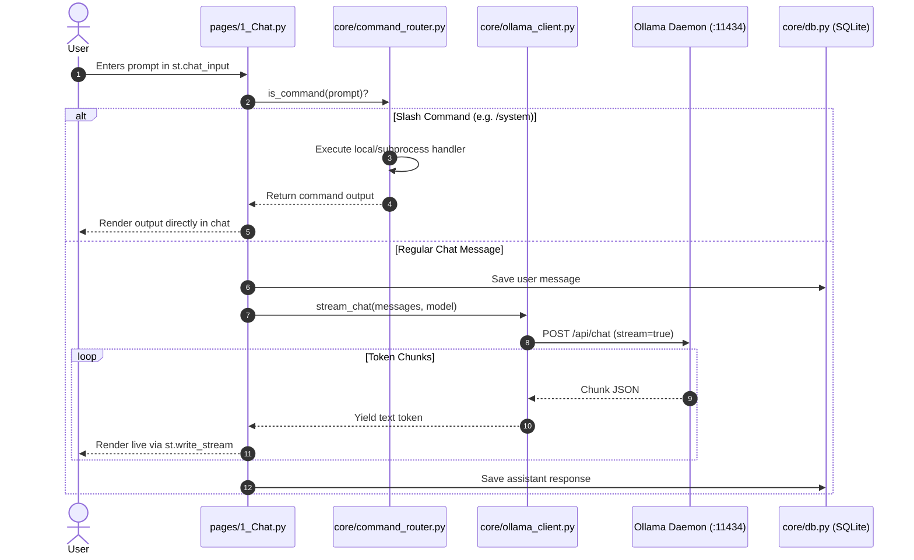

# LocalMind — System Architecture & Migration Design

## 1. Directory Structure

```bash
offline_Ai_chatbot/
├── docs/                      # Architectural, planning, audit, and phase documentation
│   ├── PLAN.md                # Migration plan, scope, tech stack, out-of-scope list
│   ├── AUDIT.md               # Codebase audit, reusable components, tech debt analysis
│   ├── ARCHITECTURE.md        # Folder structure, responsibilities, data flow
│   ├── DATABASE.md            # SQLite schema, tables, constraints, migrations
│   ├── COMMANDS.md            # Slash-command router & subprocess safety rules
│   ├── PROGRESS.md            # Master phase checklist
│   └── phases/
│       ├── PHASE_1.md         # Working local chat (MVP) & legacy reuse
│       ├── PHASE_2.md         # Hardware check, model recommender, slash commands
│       ├── PHASE_3.md         # SQLite persistence, sidebar history, search/export
│       ├── PHASE_4.md         # Settings, personas, Eco mode, hardware monitor
│       ├── PHASE_5.md         # Optional cloud fallback, quota tracking, privacy
│       └── PHASE_6.md         # File attach, offline voice, testing, Docker, CI
├── app.py                     # Streamlit application entry point & navigation
├── pages/                     # Streamlit multi-page structure (Thin UI)
│   ├── 1_Chat.py              # Main interactive chat interface
│   ├── 2_Hardware_&_Models.py # Device inspection, model recommender, puller
│   └── 3_Settings.py          # Personas, Eco mode, API keys, export
├── core/                      # Pure Python business logic layer (no UI code)
│   ├── __init__.py
│   ├── config.py              # Application settings, paths, defaults
│   ├── ollama_client.py       # Refactored Ollama client with streaming generators
│   ├── system_info.py         # Hardware probing (RAM, CPU, GPU detection)
│   ├── recommender.py         # Model suitability heuristic & tier scoring
│   ├── command_router.py      # Pre-LLM slash command interceptor
│   ├── subprocess_runner.py   # Secure, whitelisted subprocess executor
│   ├── db.py                  # SQLite database connection, tables, queries
│   ├── providers.py           # Provider interface (Ollama vs. Cloud API)
│   ├── audio.py               # Local voice transcription (faster-whisper)
│   └── file_reader.py         # Refactored PDF & TXT extraction from backend/main.py
├── tests/                     # Unit and integration test suite
├── legacy/                    # Archived backend/ and frontend/ (created post-Phase 1)
├── backend/                   # Preserved original FastAPI backend (until Phase 1 approval)
├── frontend/                  # Preserved original HTML/JS frontend (until Phase 1 approval)
├── requirements.txt           # Merged Python dependency specifications
├── pyproject.toml             # uv package configuration
├── .gitignore                 # Merged git ignore definitions
└── README.md                  # Project overview and run guide
```

---

## 2. Module Responsibilities & Legacy Reuse

### UI Layer (`app.py`, `pages/`)
- **Strictly Presentation**: Streamlit components only (`st.chat_input`, `st.chat_message`, `st.sidebar`, `st.selectbox`, `st.write_stream`).
- **No Subprocesses or Raw HTTP**: Pages invoke functions from `core/` and never execute shell commands or HTTP calls directly.
- **Thin UI Principle**: Keeps UI code simple, declarative, and easy to explain.

### Core Logic Layer (`core/`)

1. **`core/config.py`**:
   - Centralizes constants, SQLite database path (`./localmind.db`), default Ollama URL (`http://localhost:11434`), allowed model regex, and generation parameter bounds.
2. **`core/ollama_client.py` (Reuses & refactors `backend/main.py`)**:
   - Reuses URL logic from `backend/main.py` (`OLLAMA_BASE_URL`).
   - Reuses model tagging logic from `backend/main.py` (`/models` -> `GET /api/tags`).
   - Refactors `backend/main.py` `/chat` endpoint from blocking JSON into an `httpx.stream` generator, streaming text chunks for `st.write_stream`.
3. **`core/file_reader.py` (Reuses `backend/main.py` `/upload`)**:
   - Extracts and sanitizes plain text from `.txt` files.
   - Reuses `PyPDF2.PdfReader` logic from `backend/main.py` to extract page text from uploaded `.pdf` documents.
4. **`core/recommender.py` (Ports `frontend/script.js` `badgeForModel`)**:
   - Ports model classification badges from JavaScript into Python.
   - Categorizes hardware into tiers (Light < 8GB, Medium 8–16GB, Strong > 16GB) and calculates traffic-light verdicts (Green, Yellow, Red).
5. **`core/system_info.py`**:
   - Inspects total/available RAM, CPU cores, CPU percentage via `psutil`.
   - Checks GPU availability safely without crashing if drivers are absent.
6. **`core/subprocess_runner.py`**:
   - Executes only whitelisted commands: `list`, `ps`, `show`, `stop`, `rm`, `--version`.
   - Bans `shell=True`. Arguments are passed as explicit lists with a 10s timeout.
   - Validates model names with regex `^[a-zA-Z0-9_\-\.:]+$`.
7. **`core/command_router.py`**:
   - Intercepts commands starting with `/` (`/models`, `/running`, `/unload`, `/system`, `/clear`, `/help`) before LLM submission.
8. **`core/db.py` (Replaces `backend/main.py` `sessions` dict)**:
   - Manages SQLite connection pooling in WAL mode.
   - Persists `conversations`, `messages`, `settings`, and `usage_stats`.
9. **`core/providers.py`**:
   - Defines `BaseLLMProvider` interface with `OllamaProvider` (offline) and optional `OpenAICompatibleProvider` (cloud fallback).

---

## 3. Data Flow Diagrams

### A. Chat Prompt Flow (Streaming)


---

## 4. Legacy Code Retention Policy

- **Current State**: `backend/` and `frontend/` remain in place during Phase 1 development to ensure immediate reference and fallback testing.
- **Archival Milestone**: After Phase 1 is completed and approved, `backend/` and `frontend/` will be moved into `legacy/` (e.g., `legacy/backend/` and `legacy/frontend/`). No code will be deleted.
