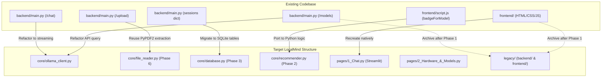

# LocalMind — Codebase Audit & Migration Map

## 1. Executive Summary
This audit reviews the existing codebase of `offline_Ai_chatbot`, which currently comprises a FastAPI backend ([`backend/main.py`](file:///C:/Users/Anuj%20Kumar/OneDrive/Documents/Projects/offline_Ai_chatbot/backend/main.py)), an HTML/CSS/JavaScript web client ([`frontend/`](file:///C:/Users/Anuj%20Kumar/OneDrive/Documents/Projects/offline_Ai_chatbot/frontend/)), and project configuration files ([`pyproject.toml`](file:///C:/Users/Anuj%20Kumar/OneDrive/Documents/Projects/offline_Ai_chatbot/pyproject.toml), [`requirements.txt`](file:///C:/Users/Anuj%20Kumar/OneDrive/Documents/Projects/offline_Ai_chatbot/requirements.txt)).

The project is undergoing an in-place migration to **LocalMind**, replacing the HTML/CSS/JS frontend with a pure-Python **Streamlit** user interface. This eliminates front-end complexity, enables native response streaming, introduces hardware-aware recommendations, adds safe offline slash commands, and introduces persistent SQLite storage.

---

## 2. What Currently Works (Reusable Assets)

| Existing Component | Current Implementation | Reusable Logic in `core/` | Notes / Adaptations |
| :--- | :--- | :--- | :--- |
| **Model Listing** | `backend/main.py` -> `GET /models` queries `http://localhost:11434/api/tags` via `httpx.AsyncClient` | Refactor into `core/ollama_client.py` (`list_models()`) | Reusable logic; wrap in sync/async `httpx` and handle timeouts. |
| **Chat Proxy** | `backend/main.py` -> `POST /chat` builds JSON payload, injects system prompt, calls `http://localhost:11434/api/chat` with `num_predict: 400` | Refactor into `core/ollama_client.py` (`stream_chat()`) | Convert from blocking `stream: False` to generator `stream: True` for `st.write_stream`. |
| **PDF Text Extraction** | `backend/main.py` -> `POST /upload` reads bytes and extracts page text via `PyPDF2.PdfReader` | Refactor into `core/file_reader.py` (`extract_pdf_text()`) | Perfect for Phase 6 in-context document ingestion. |
| **Plain Text Ingestion** | `backend/main.py` -> `POST /upload` decodes `.txt` bytes as UTF-8 | Refactor into `core/file_reader.py` (`extract_txt_text()`) | Reusable directly without alteration. |
| **Model Badging Heuristic** | `frontend/script.js` -> `badgeForModel(name)` classifies models into `'Code'`, `'Fast'`, `'Smart'`, `'Reason'`, `'Light'` | Refactor into Python in `core/recommender.py` | Port classification logic to Python for hardware tier tagging. |

---

## 3. Frontend Features to Recreate in Streamlit

| Frontend (HTML/JS) Feature | `frontend/` Source | Equivalent Streamlit Implementation in `pages/` |
| :--- | :--- | :--- |
| **Chat Message Rendering** | Dynamic DOM creation with user/assistant bubbles | Native `st.chat_message("user")` and `st.chat_message("assistant")` |
| **Real-time Token Streaming** | Not supported (waits for full JSON, then renders) | Native `st.write_stream(token_generator)` |
| **Chat Input** | Custom textarea with auto-grow and Enter key handling | Native `st.chat_input("Message the local model...")` |
| **Model Selector** | `<select id="modelSelect">` dropdown | Native `st.selectbox("Select Model", options=models)` |
| **Connection Status Indicator** | Signal panel with animated glowing LED (`online`/`offline`) | Streamlit status pill / `st.sidebar.caption` with color indicators |
| **Chat History & Sessions** | Sidebar list with click listeners calling `GET /sessions/{id}` | Streamlit sidebar buttons / radio selecting active conversation |
| **New Chat Action** | `#newChatBtn` event listener resetting session ID | `st.sidebar.button("➕ New Chat")` resetting `st.session_state` |
| **File Attachment** | Paperclip button triggering hidden file input | `st.file_uploader(type=["txt", "pdf"])` in chat sidebar or expander |
| **Code Highlighting & Markdown** | `marked.js` + `highlight.js` bundles | Streamlit native markdown parser with built-in syntax highlighting |

---

## 4. Technical Debt & Identified Risks

1. **In-Memory Session Storage**:
   - `backend/main.py` maintains `sessions: Dict[str, List[dict]] = {}`.
   - *Impact*: Any server restart or crash permanently loses all conversations.
   - *Fix*: Transition to SQLite (`localmind.db`) in Phase 3.
2. **Blocking / Non-Streaming Chat Requests**:
   - `backend/main.py` sets `"stream": False` and waits up to 120 seconds before returning the entire response.
   - *Impact*: Poor user experience on larger models, leading to perceived freezes.
   - *Fix*: Stream tokens chunk-by-chunk using `httpx.stream` and `st.write_stream`.
3. **Outdated Documentation**:
   - `README.md` previously referenced Flask (`python app.py` on port 5000), while the backend is actually FastAPI on port 8000.
   - *Fix*: Updated `README.md` to document the unified Streamlit entry point.
4. **Python Version Incompatibility Risk (`requires-python = ">=3.14"`)**:
   - `pyproject.toml` currently requires Python `>=3.14`.
   - *Risk*: Python 3.14 is unreleased/pre-release. Pre-compiled binary wheels for machine learning, audio processing (`faster-whisper`, `ctranslate2`, `torch`), and lower-level system libraries are unavailable or unstable on 3.14.
   - *Recommendation*: Pin environment target to **Python 3.12**, which has universal, stable wheel support across Windows, macOS, and Linux.
5. **No Subprocess Hardening or Model Sanitization**:
   - Currently, there are no administrative system calls or safety checks for model names.
   - *Fix*: Implement strict command whitelisting (`list`, `ps`, `show`, `stop`, `rm`, `--version`) and regex validation in `core/subprocess_runner.py`.

---

## 5. Migration Map

### Detailed File Mapping

| Source File / Logic | Target File | Phase | Status / Action |
| :--- | :--- | :--- | :--- |
| `backend/main.py` -> `GET /models` | `core/ollama_client.py` | Phase 1 | Extract Ollama communication logic |
| `backend/main.py` -> `POST /chat` | `core/ollama_client.py` | Phase 1 | Upgrade to token-by-token streaming |
| `frontend/index.html` + `script.js` | `app.py` & `pages/1_Chat.py` | Phase 1 | Rebuild as thin Streamlit UI |
| `frontend/script.js` -> `badgeForModel()` | `core/recommender.py` | Phase 2 | Port to hardware-aware tiering |
| `backend/main.py` -> `sessions` dict | `core/database.py` | Phase 3 | Replace with persistent SQLite database |
| `backend/main.py` -> `POST /upload` (PDF/TXT) | `core/file_reader.py` | Phase 6 | Reuse `PyPDF2` in-context text reader |
| `backend/` and `frontend/` directories | `legacy/backend/`, `legacy/frontend/` | Post-Phase 1 | Move to `legacy/` once Phase 1 is verified |
