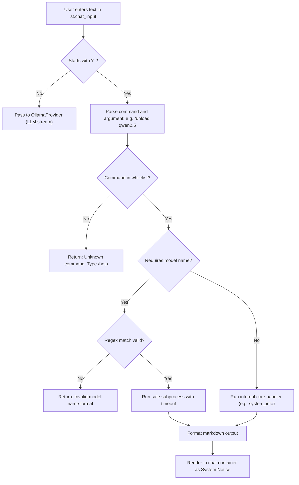

# LocalMind — Command Router & Subprocess Safety Specification

## 1. Objective
LocalMind includes an offline **Slash Command Router** that intercepts administrative and diagnostic commands entered into the chat input before they reach the language model. 
This allows users to monitor running processes, unload heavy models from RAM/VRAM, and inspect system resources completely offline without consuming LLM compute.

---

## 2. Slash Commands Specification

All commands begin with a forward slash (`/`). When detected, the router bypasses the LLM and executes local Python logic or safe subprocess calls.

| Command | Arguments | Description | Execution Mechanism |
| :--- | :--- | :--- | :--- |
| `/models` | None | Lists all locally installed Ollama models with sizes | `core/ollama_client.py` API or safe `ollama list` |
| `/running` | None | Lists models currently loaded in RAM/VRAM | Safe `ollama ps` subprocess |
| `/unload` | `<model_name>` | Immediately unloads a model from memory to free RAM | Safe `ollama stop <model>` subprocess |
| `/system` | None | Displays current CPU load, RAM free/used, and GPU status | `core/system_info.py` via `psutil` |
| `/clear` | None | Clears messages from the current conversation view | `st.session_state` reset |
| `/help` | None | Displays all available slash commands and usage | Static help dictionary |

---

## 3. Subprocess Safety Architecture

To protect user systems against command injection, process hijacking, and unexpected crashes, all subprocess operations in LocalMind adhere to four non-negotiable rules:

### Rule 1: Strict Command Whitelist
Only explicitly approved Ollama subcommands may ever be invoked:
- `ollama list`
- `ollama ps`
- `ollama show <model>`
- `ollama stop <model>`
- `ollama rm <model>`
- `ollama --version`

Any command or argument outside this whitelist is rejected immediately.

### Rule 2: Absolute Ban on `shell=True`
Subprocesses are executed **strictly** with list arguments. Passing strings to a system shell (`cmd.exe`, PowerShell, `/bin/sh`) is strictly prohibited.

```python
# ❌ STRICTLY FORBIDDEN:
# subprocess.run(f"ollama stop {model}", shell=True)

# ✅ MANDATORY PATTERN:
subprocess.run(["ollama", "stop", model], shell=False, timeout=10)
```

### Rule 3: Regex Validation for Model Identifiers
Any dynamic argument representing a model name is verified against a strict regex before passing it to `subprocess.run`:

```python
import re

MODEL_NAME_REGEX = re.compile(r"^[a-zA-Z0-9_\-\.:]+$")

def validate_model_name(name: str) -> bool:
    """Return True if model name contains only safe alphanumeric/tag characters."""
    return bool(MODEL_NAME_REGEX.match(name))
```

If a string contains spaces, semicolons, pipes, backticks, or control characters, execution is aborted with a validation error.

### Rule 4: Mandatory Timeouts & Return Code Checks
All subprocess calls must specify an explicit timeout (default: 10 seconds) to prevent frozen processes from blocking the Streamlit server thread:

```python
import subprocess
from typing import Tuple

def run_safe_ollama_cmd(args: list[str], timeout: int = 10) -> Tuple[bool, str]:
    """Execute whitelisted Ollama command securely."""
    try:
        result = subprocess.run(
            ["ollama"] + args,
            capture_output=True,
            text=True,
            shell=False,
            timeout=timeout,
            check=False
        )
        if result.returncode == 0:
            return True, result.stdout.strip()
        return False, result.stderr.strip() or f"Command failed with code {result.returncode}"
    except subprocess.TimeoutExpired:
        return False, f"Command timed out after {timeout} seconds."
    except FileNotFoundError:
        return False, "Ollama executable not found in system PATH."
    except Exception as e:
        return False, f"Execution error: {str(e)}"
```

---

## 4. Command Router Execution Pipeline



---

## 5. Standard Command Output Formatting

Command outputs are rendered using Streamlit native alert/info boxes or code blocks:
- `/system`: Rendered as an info card showing:
  - **RAM**: `8.2 GB used / 16.0 GB total (51.2%)`
  - **CPU**: `12 Cores (8 physical) — 18.5% Load`
  - **GPU**: `NVIDIA GeForce RTX 3060 (6.0 GB VRAM) — Active`
- `/running`: Rendered as a markdown table listing model name, VRAM allocation, and time loaded.
- `/unload <model>`: Rendered as a success message: `✅ Successfully unloaded <model> from memory.`
