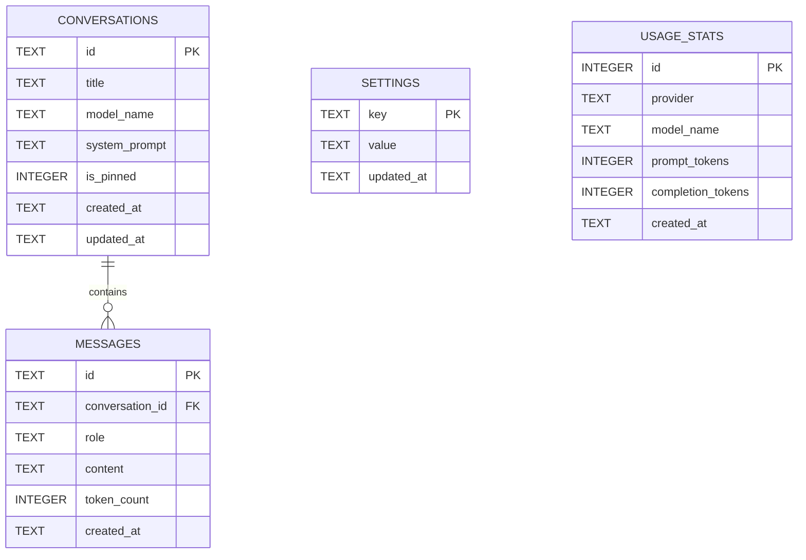

# LocalMind — SQLite Database Specification

## 1. Overview
LocalMind uses an embedded **SQLite 3** database stored at `./localmind.db` in the project root.
The database provides persistent storage for chat sessions, historical message turns, user configuration options, and token usage analytics.

---

## 2. Pragmas & Connection Settings

To maximize performance, data integrity, and cross-thread concurrency within Streamlit's multi-threaded model, connections are initialized with:

```sql
PRAGMA journal_mode = WAL;         -- Write-Ahead Logging for high concurrency
PRAGMA synchronous = NORMAL;       -- Balances durability with disk write speed
PRAGMA foreign_keys = ON;          -- Strict enforcement of relational constraints
PRAGMA temp_store = MEMORY;        -- Stores temporary tables and indices in RAM
PRAGMA busy_timeout = 5000;        -- Prevents database locked errors up to 5 seconds
```

---

## 3. Schema Definition



### Table: `conversations`
Stores conversation metadata and configurations.

```sql
CREATE TABLE IF NOT EXISTS conversations (
    id TEXT PRIMARY KEY,                       -- UUID v4
    title TEXT NOT NULL DEFAULT 'New Chat',    -- Human-readable title
    model_name TEXT NOT NULL,                  -- Model used (e.g. 'qwen2.5-coder:7b')
    system_prompt TEXT,                        -- Custom persona/system prompt used
    is_pinned INTEGER NOT NULL DEFAULT 0,      -- 0 = regular, 1 = pinned to top
    created_at TEXT NOT NULL,                  -- ISO 8601 UTC timestamp
    updated_at TEXT NOT NULL                   -- ISO 8601 UTC timestamp
);
```

### Table: `messages`
Stores individual conversation turns.

```sql
CREATE TABLE IF NOT EXISTS messages (
    id TEXT PRIMARY KEY,                       -- UUID v4
    conversation_id TEXT NOT NULL,             -- Foreign key to conversations.id
    role TEXT NOT NULL CHECK(role IN ('system', 'user', 'assistant')),
    content TEXT NOT NULL,                     -- Textual message content
    token_count INTEGER DEFAULT 0,             -- Estimated/actual token count
    created_at TEXT NOT NULL,                  -- ISO 8601 UTC timestamp
    FOREIGN KEY (conversation_id) 
        REFERENCES conversations(id) 
        ON DELETE CASCADE
);
```

### Table: `settings`
Stores persistent user preferences (key-value store).

```sql
CREATE TABLE IF NOT EXISTS settings (
    key TEXT PRIMARY KEY,                      -- Configuration key
    value TEXT NOT NULL,                       -- JSON-serialized or string value
    updated_at TEXT NOT NULL                   -- ISO 8601 UTC timestamp
);
```

Default settings keys:
- `default_model`: Name of the default local model
- `temperature`: Float (e.g., `0.7`)
- `top_p`: Float (e.g., `0.9`)
- `max_tokens`: Integer (e.g., `512`)
- `active_persona`: Name of active persona (`"Assistant"`, `"Coder"`, `"Tutor"`)
- `eco_mode`: Boolean (`"true"` / `"false"`)
- `cloud_provider`: `"none"` | `"openai"`
- `cloud_api_key`: Stored locally (never exposed in logs)
- `cloud_quota_limit`: Max tokens allowed per month

### Table: `usage_stats`
Tracks token consumption across models and providers (especially for cloud fallback quota enforcement).

```sql
CREATE TABLE IF NOT EXISTS usage_stats (
    id INTEGER PRIMARY KEY AUTOINCREMENT,
    provider TEXT NOT NULL,                    -- 'ollama' or 'openai'
    model_name TEXT NOT NULL,
    prompt_tokens INTEGER NOT NULL DEFAULT 0,
    completion_tokens INTEGER NOT NULL DEFAULT 0,
    created_at TEXT NOT NULL
);
```

---

## 4. Indices & Performance Optimization

```sql
-- Fast sorting and lookup of conversations by last updated timestamp
CREATE INDEX IF NOT EXISTS idx_conversations_updated_at 
ON conversations(updated_at DESC);

-- Fast lookup of messages belonging to a conversation, ordered chronologically
CREATE INDEX IF NOT EXISTS idx_messages_conversation_id_created 
ON messages(conversation_id, created_at ASC);

-- Efficient aggregation of token usage by provider
CREATE INDEX IF NOT EXISTS idx_usage_stats_provider_date 
ON usage_stats(provider, created_at);
```

---

## 5. Schema Migration & Versioning Strategy

LocalMind utilizes SQLite's internal `PRAGMA user_version` to track schema revisions.
On startup, `core/db.py` executes:

```python
def check_and_migrate(conn: sqlite3.Connection) -> None:
    current_version = conn.execute("PRAGMA user_version;").fetchone()[0]
    
    if current_version == 0:
        # Initial schema creation (Version 1)
        create_v1_tables(conn)
        conn.execute("PRAGMA user_version = 1;")
        conn.commit()
        
    # Future migrations check:
    # if current_version < 2:
    #     apply_v2_migration(conn)
    #     conn.execute("PRAGMA user_version = 2;")
```
